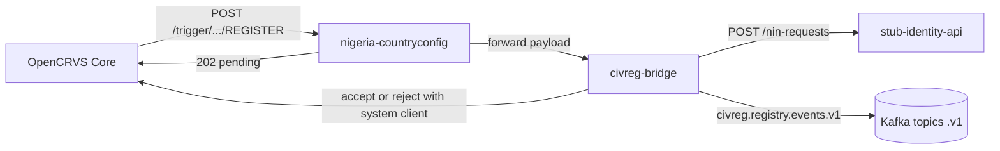

# nims-civreg-demo

Nigeria CRS on **OpenCRVS 2.1.2**. Country config is scaffolded from the official template. I did not fork core.

Identity here is a **stub**, not MOSIP. Kafka is local compose KRaft, plaintext. Strimzi mTLS, Keycloak, Vault, APISIX and ArgoCD are not in this repo.

More detail: `docs/design-note.md`. What I actually ran and broke: `LEARNING_LOG.md`. Install, reseed, rollback, errors: `docs/runbook.md`.

## Picture



Registrar hits Register. Core calls country config. Country config does not confirm. It forwards to civreg-bridge and answers **202**. The action stays Requested. Core unassigns the user.

Birth: bridge asks the stub for a NIN-at-birth (request only, DEMO NIN starts with `000`), publishes to `civreg.registry.events.v1`, then accepts with **its own system client**. Human tokens cannot accept or reject.

Death: same 202. Bridge opens `PENDING_APPROVAL`. A different checker JWT approves. Same person gets 403. Reverse needs a reason. It only undoes the identity-side flag. OpenCRVS cannot un-register.

## What works

- OpenCRVS v2.1.2 via Tilt on Docker Desktop Kubernetes
- Nigeria country config: 36 states + FCT, 774 GRID3 LGAs, demo offices, birth / death / marriage, NIN validators, genotype, Nigerian certificates (naira), Pidgin, coat of arms
- Roles with underscore ids (`nimc_civreg_*`). Password `test`. 2FA `000000`
- civreg-bridge intercept, stub identity, hash-chained `audit_log`, outbox to `civreg.audit.v1`
- Maker-checker death APIs (demo HS256 JWT, stands in for Keycloak)
- Helm charts in namespace `civreg` (optional). Compose `:3042` is what countryconfig still calls
- CI: lint, test, image build, Trivy. GHCR push only on `v*.*.*` tags

## What is not done or stubbed

- MOSIP
- Keycloak OIDC (demo JWT)
- NPC seam / APISIX
- Vault, ArgoCD
- Strimzi mTLS (Kafka is one compose broker, plaintext)
- Identiko SMS / email gateways (OpenCRVS still sends its own notifications)
- SIEM (audit is Postgres + Kafka, not Wazuh)
- Upstream upgrade drill
- Checker UI (approve/reverse is curl against the bridge)

## How to run (what I actually used)

OpenCRVS:

```bash
cd nigeria-countryconfig
tilt up
```

When Tilt group `1.OpenCRVS` is green, seed once from the Tilt UI (`data-seed`). Login: http://login.opencrvs.localhost — `k.mweene` / `test` / `000000`. App: http://register.opencrvs.localhost

Bridge, stub, Postgres, Kafka:

```bash
cd services
docker compose up --build
```

Postgres host port **5433**. Kafka **9092**. Bridge **3042**. Stub **3041**.

Watch Kafka after a birth register:

```bash
docker compose exec broker /opt/kafka/bin/kafka-console-consumer.sh \
  --bootstrap-server localhost:9092 \
  --topic civreg.registry.events.v1 \
  --from-beginning \
  --property print.key=true \
  --timeout-ms 5000
```

Helm (separate from compose; countryconfig still points at `host.docker.internal:3042`): `charts/civreg-bridge/INSTALL.md`.

Tests: `pnpm test` in each folder under `services/`.

## Security notes

- DEMO users, DEMO NINs, DEMO JWT secret, DEMO system-client secret. Do not use outside this laptop.
- No production secrets in git. Chart references an existing Kubernetes Secret; it does not contain the values.
- `record.action.accept` / `record.action.reject` sit on the bridge system client, never on a human role.
- Country config is the only seam Core is allowed to call for this intercept.

## Layout

```
nigeria-countryconfig/   # scaffolded country config
services/civreg-bridge/  # integration service
services/stub-identity-api/
charts/                  # Helm for bridge + stub
docs/
.github/workflows/ci.yml
```
