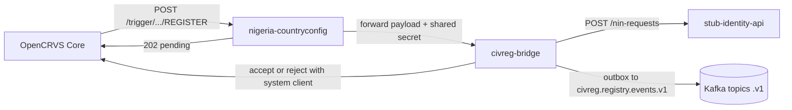

# Design note

Nigeria CRS on OpenCRVS 2.1.2. Identity here is a stub, not MOSIP. Kafka is local compose KRaft (plaintext). Strimzi mTLS is not in this demo.

Checked against `nigeria-countryconfig/src/api/action-confirmation.md` and the 2.1 action-confirmation / create-a-client / authenticate-a-client docs.

## Picture

## Birth

Registrar hits Register. Core records the action as requested and calls country config `POST /trigger/events/birth/actions/REGISTER`.

Country config does not confirm it. It forwards the payload to civreg-bridge with header `x-civreg-intercept-secret` and answers **202**. The action stays pending. Core unassigns the user who started it.

The bridge stores that request once, keyed on `eventId` + `actionId`. Payload is stripped to ids only (no declaration names or NINs). Core retries the trigger until it gets 2xx, so a second store with the same key is a no-op.

Then the bridge asks the stub for a NIN-at-birth. That is a request only — the stub does not write into a real identity register. `POST /nin-requests` returns 202 with a `requestId`. The fake NIN is not on that response; it shows up later on GET. It is 11 digits, starts with `000`, and is marked DEMO.

The bridge stores the DEMO NIN, a registration number, and a **deterministic** `transactionId` on the request row, then accepts with **its own system client**. Only after Core accepts does it enqueue `civreg.birth.registered.v1` on the **outbox** (same path as audit). A reconciler retries `pending` birth rows older than 30 seconds if the process died mid-resolve.

The token Core sent on the trigger is only proof the call came from Core. It has no scopes. Do not use it for accept or reject. A human token is refused too. `record.action.accept` and `record.action.reject` are for integrations. They must never sit on a user role: anyone who can both request a register and confirm it can skip country config.

The system client is declared in country config (`INTEGRATIONS` in `src/api/integration/handler.ts`). The Integrations page cannot create a client with those scopes.

## Death

Same 202 intercept on death REGISTER. OpenCRVS stays pending. A death without `deceased.nin` is refused (fail closed).

The bridge opens a deceased-status request as `PENDING_APPROVAL`. Maker is the registrar (`action.createdBy`). Optional `makerStaffId` / JWT `staffId` are compared when both are present so Keycloak subjects and OpenCRVS UUIDs can map to one staff id. A different checker approves (`POST /deceased-status-requests/:id/approve`). Same person gets 403.

Approve is a short saga: (1) stub deceased-status with an idempotency key, mark `stub_done`; (2) Core accept, mark `core_done`; (3) status `APPROVED`. If Core fails after the stub, the bridge calls a compensating reverse on the stub and clears `stub_done`. Reject calls `register.reject`. Reverse needs a non-empty reason and the checker role. It only undoes the identity-side deceased flag. OpenCRVS cannot un-register.

Callers use a demo HS256 JWT (`sub` + `role`, optional `staffId`). That stands in for Keycloak OIDC (RS256 / JWKS in production). Not production.

Every transition writes `audit_log` and an `outbox` row in one database transaction. A loop then publishes to Kafka with `FOR UPDATE SKIP LOCKED`. If the broker is down, the row stays unpublished and is retried. That is the outbox: do not talk to Kafka inside the business transaction.

## Audit

Every state change appends a row to `audit_log` in the same database transaction as the change. Each row stores `prev_hash` (SHA-256 of the previous row, or 64 zeros for the first one) and its own `row_hash`. Kafka `civreg.audit.v1` is fed from the `outbox` table so a broker outage cannot drop the audit event. Replay uses the outbox row id as the CloudEvents `id`. The chain is tamper-evident, not tamper-proof against a DB admin — the external Kafka/SIEM copy is the anchor.

## Events

Envelope and topic names: `docs/events.md`.

## Known limits (honest)

- Demo JWT is HS256 with a shared secret, not Keycloak RS256/JWKS.
- Maker vs checker still needs one staff id map when Keycloak `sub` is not the OpenCRVS `createdBy` UUID. Optional JWT `staffId` / row `maker_staff_id` are the path.
- Request rows store ids only (declaration PII stripped). Kafka birth events still carry a DEMO NIN in `data` for this demo. Production should carry a token or reference (PSUT-style), not the national number.
- Audit hash chain is tamper-evident, not tamper-proof against a DB admin. `civreg.audit.v1` is the external anchor. Global advisory lock on audit append is fine for a laptop, a throughput ceiling in production.
- Outbox drain uses `FOR UPDATE SKIP LOCKED` and is still at-least-once. Consumers dedupe on envelope `id`. A crash between send and mark can still duplicate.
- Kafka is one compose broker, plaintext, replication factor 1. `kafkajs` 2.2.4 is unmaintained. No dead-letter topic. Strimzi mTLS is not built.
- Helm charts are a packaging demo. Countryconfig still calls compose `host.docker.internal:3042` unless you change `CIVREG_BRIDGE_URL`. Image tag `0.1.0` is mutable (production should pin by digest). No NetworkPolicy / PDB / HPA. `helm rollback` does not undo TypeORM migrations; migrations must stay backwards compatible for one release. Birth registry events go out only after Core accept, via the outbox.
