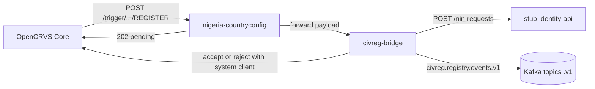

# Design note

Nigeria CRS on OpenCRVS 2.1.2. Identity here is a stub, not MOSIP. Kafka is local compose KRaft (plaintext). Strimzi mTLS is not in this demo.

Checked against `nigeria-countryconfig/src/api/action-confirmation.md` and the 2.1 action-confirmation / create-a-client / authenticate-a-client docs.

## Picture

## Birth

Registrar hits Register. Core records the action as requested and calls country config `POST /trigger/events/birth/actions/REGISTER`.

Country config does not confirm it. It forwards the payload to civreg-bridge and answers **202**. The action stays pending. Core unassigns the user who started it.

The bridge stores that request once, keyed on `eventId` + `actionId`. Core retries the trigger until it gets 2xx, so a second store with the same key is a no-op.

Then the bridge asks the stub for a NIN-at-birth. That is a request only — the stub does not write into a real identity register. `POST /nin-requests` returns 202 with a `requestId`. The fake NIN is not on that response; it shows up later on GET. It is 11 digits, starts with `000`, and is marked DEMO.

When the stub has issued the NIN, the bridge publishes `civreg.birth.registered.v1` (key = OpenCRVS eventId), then accepts the pending action with **its own system client**. REGISTER accept has to include a registration number. If the stub or Kafka send fails after retries, the bridge rejects with a reason.

The token Core sent on the trigger is only proof the call came from Core. It has no scopes. Do not use it for accept or reject. A human token is refused too. `record.action.accept` and `record.action.reject` are for integrations. They must never sit on a user role: anyone who can both request a register and confirm it can skip country config.

The system client is declared in country config (`INTEGRATIONS` in `src/api/integration/handler.ts`). The Integrations page cannot create a client with those scopes.

## Death

Same 202 intercept on death REGISTER. OpenCRVS stays pending.

The bridge opens a deceased-status request as `PENDING_APPROVAL`. Maker is the registrar (`action.createdBy`). A different person with the checker role approves (`POST /deceased-status-requests/:id/approve`). The same person gets 403. Approval sends `POST /deceased-status-events` to the stub, then the system client accepts REGISTER. Reject calls `register.reject`. Reverse needs a non-empty reason and the checker role. It only undoes the identity-side deceased flag. OpenCRVS cannot un-register.

Callers use a demo HS256 JWT (`sub` + `role`). That stands in for Keycloak OIDC. Not production.

Every transition writes `audit_log` and an `outbox` row in one database transaction. A loop then publishes `civreg.audit.appended.v1` to Kafka. If the broker is down, the row stays unpublished and is retried. That is the outbox: do not talk to Kafka inside the business transaction.

## Audit

Every state change appends a row to `audit_log` in the same database transaction as the change. Each row stores `prev_hash` (SHA-256 of the previous row, or 64 zeros for the first one) and its own `row_hash`. Kafka `civreg.audit.v1` is fed from the `outbox` table so a broker outage cannot drop the audit event. Replay uses the outbox row id as the CloudEvents `id`.

## Events

Envelope and topic names: `docs/events.md`.
