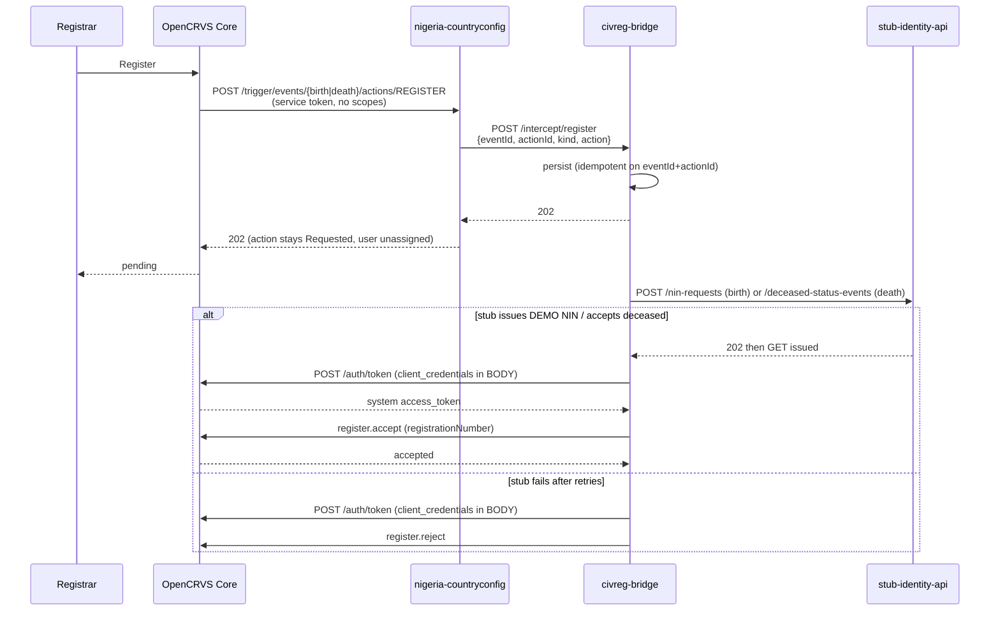

# Interception

Birth and death REGISTER are intercepted. Marriage REGISTER still accepts immediately (200 + registration number).

Confirmed interceptable from `nigeria-countryconfig/src/api/action-confirmation.md` and the 2.1 docs: NOTIFY, DECLARE, EDIT, REGISTER, REJECT, ARCHIVE, UNARCHIVE, PRINT_CERTIFICATE, CUSTOM, REQUEST_CORRECTION, APPROVE_CORRECTION, REJECT_CORRECTION. This work only changes birth and death REGISTER.

## Sequence

Auth: `grant_type=client_credentials` in `application/x-www-form-urlencoded` body. Never in the query string — 2.1 rejects that outside production.

The trigger token is not used for accept or reject. Human tokens are refused. Scopes `record.action.accept` and `record.action.reject` sit only on the `civreg-bridge` integration, not on a NIMS human role.

Logs use `eventId` and `actionId` only. No names, no NIN, no declaration fields.

## Live checks

- Birth pending then complete: countryconfig `202`, then system-client accept. Tracking id L3YKU6 was the first reject (accept payload had extra review fields); later births completed.
- `host.docker.internal:3042` from the countryconfig pod reaches compose on this Mac.
- If Integrations does not list `civreg-bridge`, restart the events pod so `/trigger/system/ready` runs again.
- Informant email/SMS after async accept still follows the template’s 200 path; not re-checked after 202.
- Death REGISTER stays pending until a checker JWT approves (`PENDING_APPROVAL`). Reverse is identity-side only.
